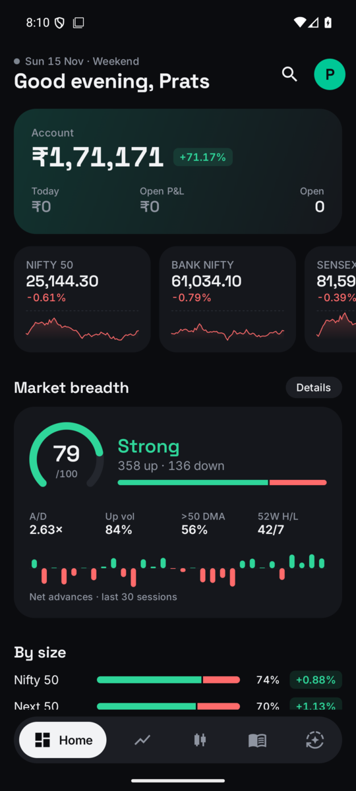
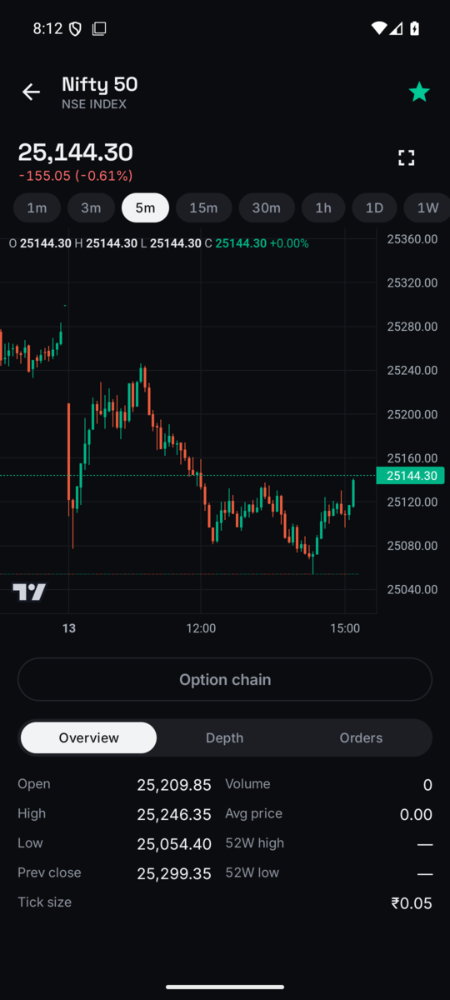
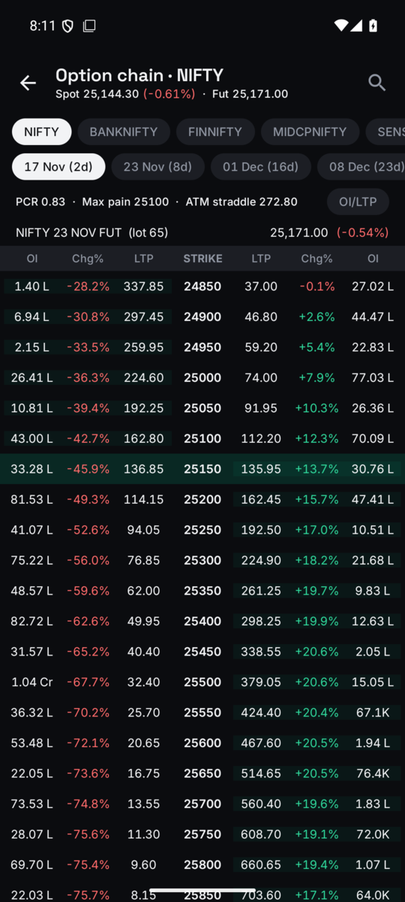
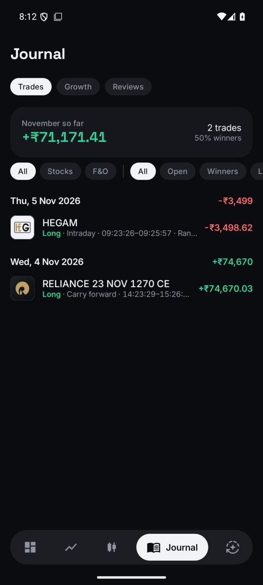

# PratsTrades

A paper-trading Android app for Indian markets. It streams real-time NSE and BSE data, runs a realistic simulated exchange entirely on the phone, and journals every trade automatically. No real orders are ever sent.

> This is a showcase repository. The source code is private; a walkthrough is available on request.

## Screenshots

<p>    </p>

All screens show sample data.

## What it does

| Area | Features |
|---|---|
| Markets | Index strip, NIFTY 50 movers, sector heatmap, market breadth, holiday calendar |
| Search | Every NSE and BSE stock and index, and every future and option contract |
| Charts | Eight timeframes, candles and Heikin-Ashi, 10+ indicators, trend lines, live ticks, fills shown as markers |
| F&O | Option chain built on the device, open interest, implied volatility, live Black-Scholes Greeks |
| Orders | Market, limit and stop-loss orders, attached stop-loss and target, risk-based sizing |
| Engine | Fills at bid and ask, margin checks, full Indian charges, auto square-off, expiry settlement |
| Journal | Every round trip recorded with entry and exit context, notes and plan adherence |
| Stats | Win rate, expectancy, profit factor, drawdown and equity curve |
| Reports | Excel profit-and-loss report and a trade journal export |

## How it is built

- **Language and UI:** Kotlin with Jetpack Compose
- **Storage:** Room database with versioned, non-destructive migrations and automatic backups
- **Market data:** Angel One SmartAPI over REST, plus a binary WebSocket feed parsed on the device
- **Simulated exchange:** order matching, margins, charges, square-off and expiry, all local
- **Catch-up replay:** when the app has been closed, it replays one-minute candles to fill pending orders
- **Charts:** TradingView Lightweight Charts in a WebView with a Kotlin bridge
- **Security:** broker credentials encrypted with the Android Keystore
- **Research:** Python scripts for backtesting strategies on historical data

```
core/      clock, market calendar, formatting
data/      REST client, WebSocket feed, database, encrypted preferences
market/    live quotes, candles, option chain, Black-Scholes
engine/    paper exchange: matching, margins, charges, square-off, expiry
journal/   statistics and exports
ui/        Compose screens and the chart bridge
```

## Size

About 14,700 lines of Kotlin across 63 files, plus Python research scripts.

## How it was made

I designed the product and directed the build with AI coding agents, reviewing and testing each release on my own phone.

## Known limits

- Fills are modelled: there is no queue position and no partial fills.
- Stock options settle in cash at expiry, where the real exchange settles physically.
